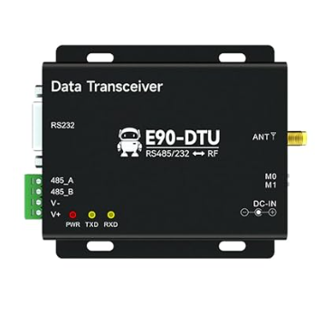

#  LoRa-Funkstrecke E90-DTU mit zwei ESP32

Bidirektionale Punkt-zu-Punkt-Strecke zwischen zwei ESP32 Dev Boards über E90-DTU-Funkmodems.

*E90-DTU: links RS232 (DB9) zum MAX3232, darunter die RS485-Klemme und die Versorgung,
rechts SMA-Antenne und die Betriebsart-Pins M0/M1.*

Eingesetzte Modems: **E90-DTU(900SL22)** auf 868,125 MHz, Sendeleistung auf 13 dBm reduziert.
Die Reduzierung ist Pflicht, nicht Geschmackssache — siehe docs/dtu-konfiguration.md.

- Controller 1 (Sensorseite) sendet zwei Schaltzustände und einen Messwert (0-100).
- Controller 2 (Schalterseite) empfängt diese Werte und sendet einen Schaltbefehl zurück,
  den Controller 1 auf einen Ausgang legt.

## Dateien

| Pfad | Inhalt |
|---|---|
| shared/lora_protocol.h | Frameaufbau, CRC16, Empfangs-Zustandsmaschine, alle Zeitkonstanten |
| controller1/controller1.ino | Sensorseite |
| controller2/controller2.ino | Schalterseite |
| linktest/linktest.ino | Hilfssketch, prüft die rohe Funkstrecke ohne Protokoll |
| docs/verdrahtung.md | Pinbelegung, Pegelwandler, Versorgung |
| docs/verdrahtung.html | dieselbe Verdrahtung als Übersichtsseite mit Modulfoto und Signalweg-Diagramm |
| docs/dtu-konfiguration.md | DTU-Parameter, Typvarianten, Duty-Cycle |

Beide Sketches binden shared/lora_protocol.h über einen relativen Pfad ein, damit Frameaufbau
und CRC nur an einer Stelle stehen. Sollte die Arduino IDE den Pfad nicht auflösen, die Datei
in beide Sketchordner kopieren, dann aber synchron halten. Mit PlatformIO tritt das Problem
nicht auf.

## Reihenfolge der Inbetriebnahme

Jede Stufe setzt die vorige voraus. Wer sie überspringt, sucht Fehler an der falschen Stelle.

1. DTU erreichbar. Im Konfigurationsmodus mit RF_Setting die Parameter auslesen. Klappt das,
   sind RS232-Kabel, Pegelwandler und Versorgung in Ordnung. Siehe docs/dtu-konfiguration.md.
2. Rohe Funkstrecke. linktest/linktest.ino auf beide Boards flashen. Auf jedem seriellen
   Monitor (115200 Baud) müssen die TEST-Bytes der Gegenseite auftauchen.
3. Hinkanal. Die beiden Sketches flashen, Zustände an Controller 1 schalten und das
   Potentiometer drehen. Controller 2 muss die Werte zeigen.
4. Rückkanal. Taster an Controller 2 drücken, der Ausgang an Controller 1 muss schalten.
5. Failsafe. Controller 2 stromlos machen. Nach 30 s fällt der Ausgang an Controller 1 ab,
   die Status-LED blinkt. Nach dem Wiedereinschalten fängt sich die Strecke selbst.
6. Reichweite. Am geplanten Standort mit montierten Antennen prüfen.

## Protokoll in Kurzform

7 Byte je Frame: Startbyte, Typ, Sequenznummer, Flags, Messwert, CRC16.

- Controller 1 sendet Telemetrie sofort bei einem Zustandswechsel, bei reinen
  Messwertänderungen höchstens alle 5 s, und ohne jede Änderung alle 10 s als Lebenszeichen.
  Die 5-s-Bremse hält den Duty-Cycle ein, auch wenn der Analogeingang zappelt.
- Controller 2 quittiert jede Telemetrie und gibt den aktuellen Schaltbefehl in der Quittung
  mit. Der Rückkanal braucht deshalb kein eigenes Lebenszeichen.
- Ändert sich der Schaltbefehl, geht er sofort als eigener Frame raus und wird quittiert.
- Ohne Quittung: 3 Wiederholungen mit 250 ms plus Zufallsanteil. Geht ein Befehlsframe
  endgültig verloren, korrigiert die nächste Quittung den Stand von selbst.
- 30 s ohne gültigen Frame: beide Seiten schalten ihre Ausgänge ab. Bei gestörter Strecke
  sendet Controller 1 nur noch alle 30 s, damit die Wiederholungen die Sendezeit nicht auffressen.
- Ein mitlaufendes Sendezeit-Budget (250 ms je 60 s) unterdrückt weitere Frames, falls die
  Intervalle doch einmal nicht reichen. Der Verbrauch steht in jeder Telemetriezeile als Luft=.

Alle Zeiten und Grenzen stehen als Konstanten am Anfang von shared/lora_protocol.h.

## Fehlersuche

| Symptom | Wahrscheinliche Ursache |
|---|---|
| gar keine Bytes | TXD/RXD nicht gekreuzt, oder Masse fehlt |
| nur unleserliche Bytes | UART-Baudrate passt nicht zur DTU-Einstellung |
| Bytes nur in eine Richtung | eine Seite hat abweichende Funkparameter |
| sporadische Verluste | normal, dafür sind Quittung und Wiederholung da |
| dauernd "keine Quittung" im Log | Reichweite, Antenne oder zu hohe Luftrate |
| nichts geht, Board ist ein WROVER | GPIO16/17 sind dort belegt, siehe docs/verdrahtung.md |

## Hardware

| Teil | Anmerkung |
|---|---|
| 2x ESP32 DevKit (WROOM-32) | WROVER geht auch, dann UART2 umlegen |
| 2x E90-DTU(900SL22) | 868 MHz, RS232/RS485, 8-28 V |
| 2x MAX3232-Modul | Pegelwandler zwischen ESP32-TTL und RS232 des DTU |
| 2x 868-MHz-Antenne, SMA | nie ohne Antenne senden |
| 2x Netzteil 12 V + Step-Down auf 5 V | Versorgung DTU und ESP32 |

Der Aufbau ist auf beiden Seiten identisch, nur die Ein- und Ausgänge der ESP32 unterscheiden sich.
Die vollständige Verdrahtung steht in docs/verdrahtung.md, als Übersichtsseite mit Modulfoto und
Signalweg-Diagramm in docs/verdrahtung.html.

## Rechtliches

868 MHz ist ein SRD-Band mit Auflagen. Sendeleistung und Duty-Cycle sind in diesem Projekt
bewusst begrenzt (13 dBm, mitlaufendes Sendezeit-Budget), siehe docs/dtu-konfiguration.md.
Wer Frequenz, Leistung oder Sendeintervalle ändert, muss selbst prüfen, ob der Betrieb am
eigenen Standort noch zulässig ist.

## Lizenz

MIT, siehe [LICENSE](LICENSE).
